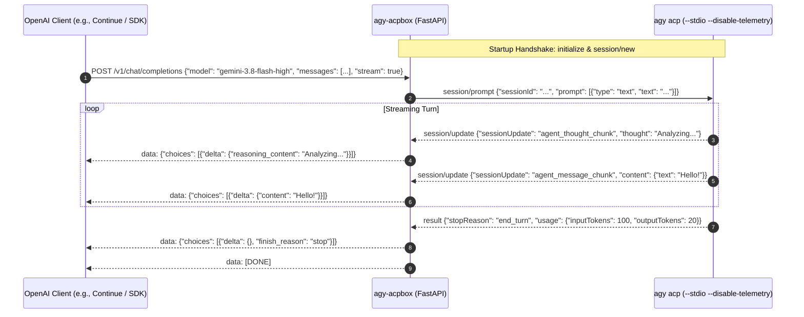

# Product Requirements Document (PRD)

## Project: `agy-acpbox` — OpenAI-Compatible API Gateway for `agy acp`
**Status:** Approved for Implementation  
**Version:** 2.0.0 (Gateway Architecture)  
**Author:** AI Systems Architecture Team  
**Target Runtime:** Python 3.11+ / FastAPI / Uvicorn  
**Target Clients:** Continue.dev, Cursor, Open WebUI, LangChain, Roo Code, OpenAI Python/TS SDKs, `curl`  
**Backend:** Google Antigravity CLI (`agy acp` stdio server)

---

## 1. Executive Summary & Problem Statement

### 1.1 Context
The **Agent Client Protocol (ACP)** is an open standard designed to standardize communication between IDEs and autonomous coding agents over JSON-RPC 2.0 on `stdio`. Google Antigravity CLI natively implements this protocol via the `agy acp` command, giving access to state-of-the-art coding and reasoning models (Gemini 3.8 Flash, Claude Sonnet 4.6 Thinking, Claude Opus, GPT-OSS).

### 1.2 Problem
The vast majority of existing AI developer tools, editors, and workflow frameworks (including Continue.dev, Cursor custom endpoints, Open WebUI, LangChain, LlamaIndex, and custom terminal assistants) integrate exclusively with the **OpenAI-Compatible REST API** format (`/v1/chat/completions` and `/v1/models`). They cannot spawn or communicate directly over JSON-RPC 2.0 standard input/output pipes with `agy acp`.

Furthermore, users require privacy and isolation guarantees—specifically requiring telemetry to be disabled (`--disable-telemetry`) and tool permissions to be streamlined (`--dangerously-skip-permissions`).

### 1.3 Solution
`agy-acpbox` is a lightweight, asynchronous Python gateway that exposes `agy acp` as a standard, high-performance **OpenAI-Compatible HTTP Server**. It translates incoming OpenAI `/v1/chat/completions` REST and Server-Sent Event (SSE) requests into ACP JSON-RPC turns, extracts thinking/reasoning and content streams, captures token usage, and automatically enforces `--disable-telemetry`.

---

## 2. Goals & Success Metrics

### 2.1 Primary Objectives
1. **OpenAI Protocol Parity:** Support standard `/v1/chat/completions` (JSON and streaming SSE) and `/v1/models` endpoints compatible with any OpenAI client library.
2. **Telemetry Protection:** Enforce `--disable-telemetry` when launching `agy acp` by default.
3. **Real-Time Streaming & Thought Separation:** Stream text tokens incrementally with sub-20ms latency and extract reasoning chunks into `delta.reasoning_content` (DeepSeek/OpenAI format).
4. **Autonomous Handshake Management:** Automatically execute ACP `initialize` and `session/new` handshakes on server startup, managing session persistence across queries.
5. **Zero-Configuration Developer Experience:** Single-command startup via `uv run agy-acpbox` with sensible defaults (`http://127.0.0.1:8000`).

### 2.2 Success Metrics
- **Streaming Latency:** First token response < 200ms after `agy acp` outputs initial token.
- **Client Compatibility:** 100% interoperability with official OpenAI Python SDK, Continue.dev, Open WebUI, and `curl`.
- **Telemetry Compliance:** 100% of subprocess invocations include `--disable-telemetry`.

---

## 3. System Architecture & Data Flow

```mermaid
flowchart LR
    subgraph Clients ["OpenAI Clients"]
        Continue[Continue.dev / Cursor]
        WebUI[Open WebUI / LibreChat]
        PythonSDK[OpenAI Python SDK / LangChain]
        Curl[cURL / HTTP Requests]
    end

    subgraph Gateway ["agy-acpbox Gateway"]
        FastAPI[FastAPI HTTP Server\n/v1/chat/completions\n/v1/models]
        ModelMapper[OpenAI <-> ACP Payload Mapper]
        ProcessMgr[AgyACPBackend Subprocess Manager\nLifecycle & Session Cache]
    end

    subgraph Daemon ["Antigravity Daemon"]
        AgyACP[agy acp --stdio\n--disable-telemetry\n--dangerously-skip-permissions]
    end

    Clients <-->|HTTP POST / GET\nSSE text/event-stream| FastAPI
    FastAPI <--> ModelMapper
    ModelMapper <--> ProcessMgr
    ProcessMgr <-->|Line-delimited JSON-RPC 2.0\nstdin / stdout| AgyACP
```



---

## 4. Sequence Diagram: Chat Completion Turn



---

## 5. Functional Requirements (FR)

### FR-1: HTTP Endpoints
- **FR-1.1: `POST /v1/chat/completions`**
  - Accept standard OpenAI request schema (`model`, `messages`, `stream`, `temperature`, `max_tokens`).
  - Concatenate conversation roles into a clean conversational context prompt for `agy acp`.
  - Non-streaming mode: accumulate all message chunks and return a standard `ChatCompletionResponse` JSON object.
  - Streaming mode (`stream: true`): return `text/event-stream` SSE chunks formatted as `data: {JSON}\n\n`, ending with `data: [DONE]\n\n`.
- **FR-1.2: `GET /v1/models` & `GET /models`**
  - Return dynamic list of models retrieved from `agy acp`'s `session/new` response (e.g., `gemini-3.8-flash-high`, `claude-sonnet-4-6`, `gpt-oss-120b-medium`).
- **FR-1.3: `GET /health`**
  - Return server health, current ACP session ID, and subprocess status.

### FR-2: Subprocess Management & Telemetry
- **FR-2.1: Default Command Flags:**
  - `agy-acpbox` must always spawn `agy acp` with `--stdio` and `--disable-telemetry`.
  - Auto-approve permissions with `--dangerously-skip-permissions` by default.
  - Forward optional `--agent` and repeatable `--add-dir` parameters.
- **FR-2.2: Handshake Lifecycle:**
  - Execute `initialize` declaring `fs` and `terminal` capabilities.
  - Execute `session/new` with project working directory.
  - Automatically restart the backend process if terminated unexpectedly.

### FR-3: Client Capability Simulation
- If `agy acp` emits a client request (such as `fs/read_text_file` or `fs/write_text_file`), the backend immediately resolves it against the local workspace so `agy acp` tool executions proceed without hanging.

### FR-4: Reasoning / Thinking Tokens
- Route `agent_thought_chunk` notifications directly into OpenAI's `delta.reasoning_content` field so UI clients supporting reasoning (Continue.dev, Open WebUI) render real-time collapsible thinking boxes.

---

## 6. CLI Specification

Running `agy-acpbox` starts the HTTP gateway directly:

```bash
Usage: agy-acpbox [OPTIONS]

Options:
  --host TEXT                          Host address to bind HTTP server [default: 127.0.0.1]
  --port INTEGER                       Port to bind HTTP server [default: 8000]
  --disable-telemetry / --enable-telemetry
                                       Enforce --disable-telemetry in agy acp [default: True]
  --dangerously-skip-permissions / --require-permissions
                                       Auto-approve tool requests in agy acp [default: True]
  --agent TEXT                         Agent persona for agy acp session
  --add-dir TEXT                       Additional workspace directories to include
  --log-level TEXT                     Log level (debug, info, warning, error) [default: info]
  --help                               Show this message and exit.
```

---

## 7. Automated Testing Strategy
1. **Backend Command & Flags:** Validates `--disable-telemetry` is present on process invocation.
2. **Models Endpoint:** Validates `GET /v1/models` returns model items conforming to OpenAI schema.
3. **Non-Streaming Chat Completion:** Validates complete text payload and `usage` token mapping.
4. **Streaming SSE Chat Completion:** Validates chunk structure, thought delta extraction, and final `[DONE]` delimiter.
5. **Live Antigravity Integration:** Tests handshake and model discovery against the live `agy acp` binary on the host machine.
